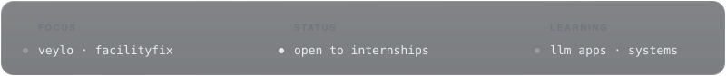
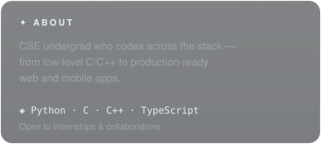
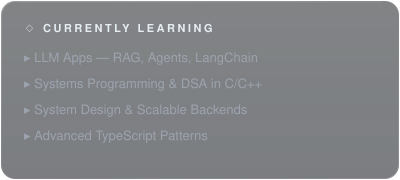
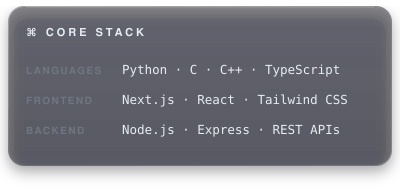
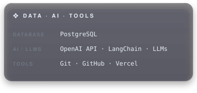
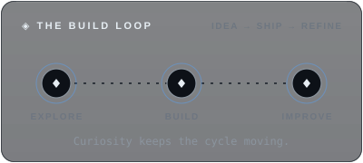

<h1 align="center">Hey, I'm Lakshit ✦</h1>

  CSE UNDERGRAD &nbsp;·&nbsp; FULL-STACK DEV &nbsp;·&nbsp; BUILDING REAL PRODUCTS

  

  <a href="https://lakshitss.vercel.app/">Portfolio</a> &nbsp;·&nbsp;
  <a href="https://github.com/hmmlavi">GitHub</a> &nbsp;·&nbsp;
  <a href="https://x.com/Lakshits27">X</a> &nbsp;·&nbsp;
  <a href="https://www.instagram.com/lakshitsinghsaini/">Instagram</a> &nbsp;·&nbsp;
  <a href="mailto:lakshitsinghsaini@gmail.com">Email</a>

  

 

  
  

  
  

<b>◈ &nbsp;F E A T U R E D &nbsp; P R O J E C T S</b>

| Project | What I'm building |
|:--|:--|
| [FacilityFix](https://github.com/hmmlavi/FacilityFix) | A platform for reporting and managing campus facility issues. |
| [SaBuddy](https://github.com/hmmlavi/SaBuddy) | A practical student-focused assistant project. |
| [Veylo](https://github.com/hmmlavi/Veylo) | A focused web experience with a clean, interactive interface. |
| [Sortify Desktop](https://github.com/hmmlavi/sortify-desktop) | AI-assisted file naming and organization for desktop workflows. |
| [Pustakalaya LMS](https://github.com/hmmlavi/Pustakalaya-LMS) | A library management system with desktop distribution and tests. |

<b>◈ &nbsp;B U I L D &nbsp; A C T I V I T Y</b>

  
  

  <a href="https://github.com/hmmlavi">Explore my GitHub profile and contribution history ↗</a>

  ✦ &nbsp;Always building something new — let's connect  
  <a href="mailto:lakshitsinghsaini@gmail.com">lakshitsinghsaini@gmail.com</a>
  &nbsp;·&nbsp;
  <a href="https://lakshitss.vercel.app/">lakshitss.vercel.app</a>

