  

  

## Tools of Trade

  

  

  
  &nbsp;
  
  &nbsp;
  
  &nbsp;
  

  

  

## GitHub, Lately

  A little signal from the things I build, learn, and contribute to.

<table align="center" border="0" cellpadding="8" cellspacing="0">
  <tr>
    <td width="50%" align="center">
      
    </td>
    <td width="50%" align="center">
      
    </td>
  </tr>
</table>

  THE CONTRIBUTION TRAIL

  

  Numbers refresh daily · contribution trail follows the GitHub activity grid.

