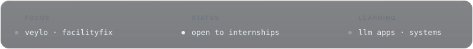
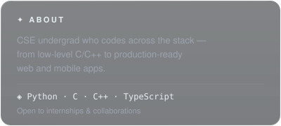
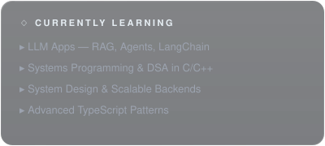
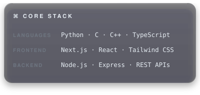
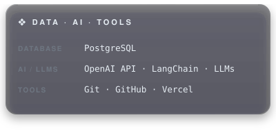
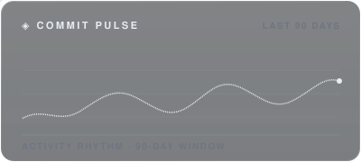
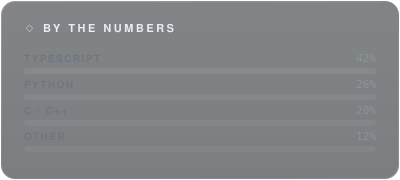
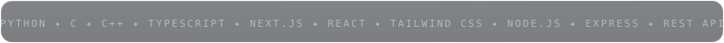

<h1 align="center">Hey, I'm Lakshit ✦</h1>

  CSE UNDERGRAD &nbsp;·&nbsp; LOW-LEVEL TO FULL-STACK &nbsp;·&nbsp; BUILDING REAL PRODUCTS

  

  
  
  
  
  

 

  
  

  
  

  
  

 

<b>◈ &nbsp;F E A T U R E D &nbsp; P R O J E C T S</b>

  
  
  

<b>◈ &nbsp;S T A T S</b>

  
  
  

  ✦ &nbsp;Always building something new — let's connect  
  <a href="mailto:lakshitsinghsaini@gmail.com">lakshitsinghsaini@gmail.com</a>
  &nbsp;·&nbsp;
  <a href="https://lakshitss.vercel.app/">lakshitss.vercel.app</a>

