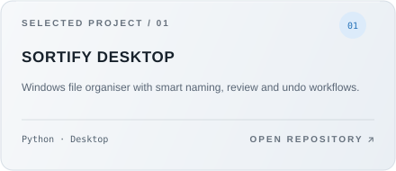
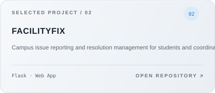
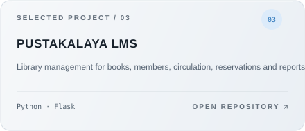
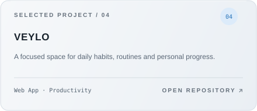
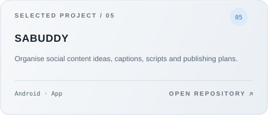

  

  <a href="https://github.com/hmmlavi">GitHub</a> ·
  <a href="https://lakshitss.vercel.app/">Portfolio</a> ·
  <a href="https://github.com/hmmlavi?tab=repositories">Repositories</a>

  

## Selected work

  <a href="https://github.com/hmmlavi/sortify-desktop" title="SORTIFY DESKTOP"><picture></picture></a><a href="https://github.com/hmmlavi/FacilityFix" title="FACILITYFIX"><picture></picture></a> <a href="https://github.com/hmmlavi/Pustakalaya-LMS" title="PUSTAKALAYA LMS"><picture></picture></a><a href="https://github.com/hmmlavi/Veylo" title="VEYLO"><picture></picture></a> <a href="https://github.com/hmmlavi/SaBuddy" title="SABUDDY"><picture></picture></a>

## A little about me

I'm a Computer Science student from India who enjoys exploring different fields and turning ideas into useful software. I'm interested in **AI, desktop applications, developer tools, web development, and product development** — but I don't want to limit myself to one area.

Outside technology, I'm usually exploring **gaming, space, music, or psychology**. I like learning how things work, why they work, and what I can make from that curiosity.

## Tools I use

  
  

## What I'm exploring

  

---

Still exploring. Still building. Always curious.

