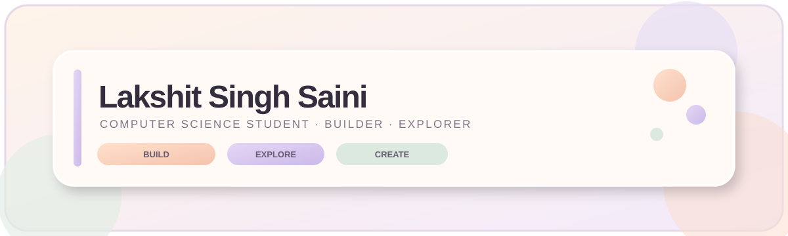

  

  <a href="https://github.com/hmmlavi">GitHub</a>
  &nbsp;·&nbsp;
  <a href="https://lakshitss.vercel.app/">Portfolio</a>
  &nbsp;·&nbsp;
  <a href="mailto:lakshitsinghsaini@gmail.com">Email</a>

---

### A little about me

I'm a **Computer Science student from India** who enjoys building things, exploring new ideas, and figuring out how technology can make them real.

I'm interested in **AI, developer tools, desktop applications, web development, and product building**. I like moving between different fields, learning by experimenting, and making things simply because an idea caught my attention.

Outside of code, you'll find me exploring **space, gaming, music, and psychology**. I'm curious by nature and don't really want to limit that curiosity to one thing.

### Selected work

A few things I've been working on:

| Project | What it is |
|:--|:--|
| [**FacilityFix**](https://github.com/hmmlavi/FacilityFix) | Facility issue reporting and management system |
| [**Sortify Desktop**](https://github.com/hmmlavi/sortify-desktop) | Desktop file organisation and intelligent renaming |
| [**Veylo**](https://github.com/hmmlavi/Veylo) | Offline-first habit tracking application |
| [**Pustakalaya LMS**](https://github.com/hmmlavi/Pustakalaya-LMS) | Library management system |
| [**SaBuddy**](https://github.com/hmmlavi/SaBuddy) | AI-assisted personal workspace |

### Tools of the trade

**Languages**

  &nbsp;Python&nbsp;&nbsp;
  &nbsp;C&nbsp;&nbsp;
  &nbsp;C++&nbsp;&nbsp;
  &nbsp;JavaScript&nbsp;&nbsp;
  &nbsp;TypeScript&nbsp;&nbsp;
  &nbsp;HTML5&nbsp;&nbsp;
  &nbsp;CSS3&nbsp;&nbsp;
  &nbsp;Bash&nbsp;&nbsp;
  &nbsp;SQL

**Frameworks & libraries**

  &nbsp;React&nbsp;&nbsp;
  &nbsp;Next.js&nbsp;&nbsp;
  &nbsp;Tailwind CSS&nbsp;&nbsp;
  &nbsp;Node.js&nbsp;&nbsp;
  &nbsp;Express&nbsp;&nbsp;
  &nbsp;Flask

**Databases & backend**

  &nbsp;PostgreSQL&nbsp;&nbsp;
  &nbsp;SQLite&nbsp;&nbsp;
  &nbsp;MongoDB&nbsp;&nbsp;
  &nbsp;Supabase&nbsp;&nbsp;
  &nbsp;Firebase

**AI & development tools**

  &nbsp;Claude&nbsp;&nbsp;
  &nbsp;Gemini&nbsp;&nbsp;
  &nbsp;Codex&nbsp;&nbsp;
  &nbsp;LangChain

  &nbsp;VS Code&nbsp;&nbsp;
  &nbsp;Git&nbsp;&nbsp;
  &nbsp;GitHub&nbsp;&nbsp;
  &nbsp;GitHub Pages&nbsp;&nbsp;
  &nbsp;Figma&nbsp;&nbsp;
  &nbsp;Vercel

*Interested in LLM integration, prompt engineering, and AI-assisted development.*

---

  Always learning, always building, always curious.

