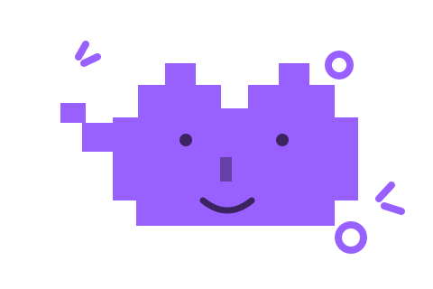
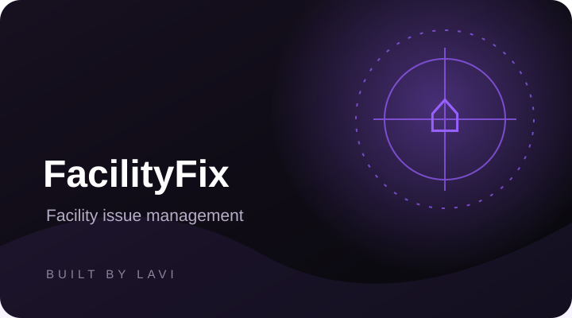
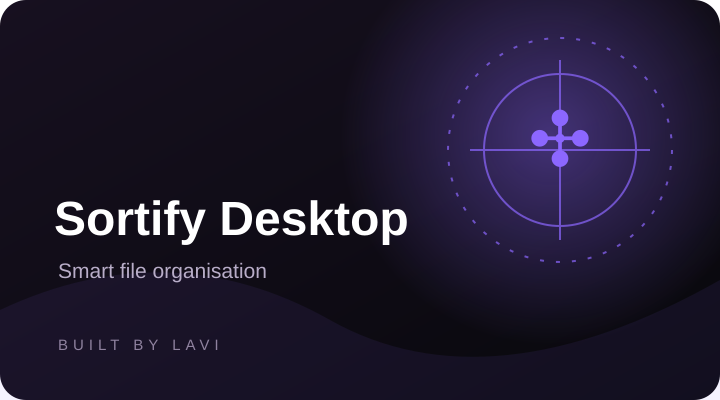
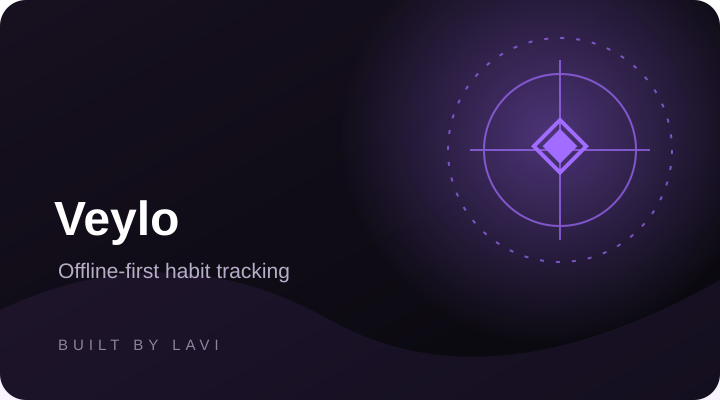
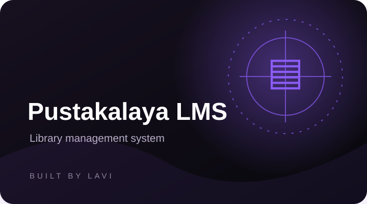
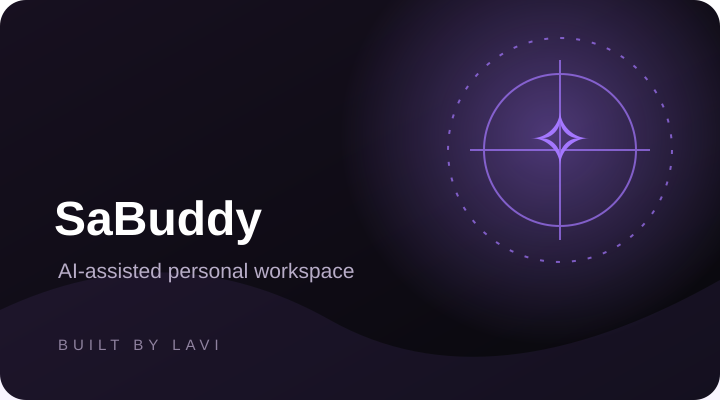

  

  <a href="#top">Home</a> &nbsp;&nbsp;
  <a href="#about">About</a> &nbsp;&nbsp;
  <a href="#projects">Projects</a> &nbsp;&nbsp;
  <a href="#tools">Skills</a> &nbsp;&nbsp;
  <a href="#contact">Contact</a>

 

<h1 align="center">Hey! , I am Lakshit</h1>
<h2 align="center">Computer Science Student · Developer</h2>

  I build useful digital products, explore new technologies, and turn ideas into working projects.

  
  &nbsp;
  

 

<h2>About Me</h2>

<table>
  <tr>
    <td width="62%" valign="middle">
      
I'm a Computer Science student from India who enjoys building things, exploring new ideas, and learning how technology works.

      
I'm interested in AI, developer tools, desktop applications, web development, and product building. I like moving between different fields and learning by experimenting.

      
Outside of code, you'll find me exploring space, gaming, music, and psychology. I'm curious by nature and don't want to limit that curiosity to one thing.

    </td>
    <td width="38%" align="center" valign="middle">
      
    </td>
  </tr>
</table>

 

<h2>Skills &amp; Technologies</h2>

<table>
  <tr>
    <td width="33%" valign="top">
      <h3>Languages</h3>
      
      
      
      
      
      
      
      
      
    </td>
    <td width="33%" valign="top">
      <h3>Development</h3>
      
      
      
      
      
      
      
      
      
      
    </td>
    <td width="34%" valign="top">
      <h3>Tools &amp; Platforms</h3>
      
      
      
      
      
      
      
      
      
    </td>
  </tr>
</table>

 

<h2 align="center">My Projects</h2>

A collection of things I've worked on, from desktop tools to web applications.

<table>
  <tr>
    <td width="33%" valign="top">
      
      <h3>FacilityFix</h3>
      
A facility issue reporting and management system.

      <a href="https://github.com/hmmlavi/FacilityFix">View Details ↗</a>
    </td>
    <td width="33%" valign="top">
      
      <h3>Sortify Desktop</h3>
      
A desktop file organisation and intelligent renaming tool.

      <a href="https://github.com/hmmlavi/sortify-desktop">View Details ↗</a>
    </td>
    <td width="34%" valign="top">
      
      <h3>Veylo</h3>
      
An offline-first habit tracking application.

      <a href="https://github.com/hmmlavi/Veylo">View Details ↗</a>
    </td>
  </tr>
  <tr>
    <td width="33%" valign="top">
      
      <h3>Pustakalaya LMS</h3>
      
A library management system built with Python and Flask.

      <a href="https://github.com/hmmlavi/Pustakalaya-LMS">View Details ↗</a>
    </td>
    <td width="33%" valign="top">
      
      <h3>SaBuddy</h3>
      
An AI-assisted personal workspace.

      <a href="https://github.com/hmmlavi/SaBuddy">View Details ↗</a>
    </td>
    <td width="34%" valign="top">
      <h3>More coming soon</h3>
      
Always experimenting with new ideas and building things along the way.

    </td>
  </tr>
</table>

 

<h2 align="center">Let's Connect</h2>

Have an idea, want to collaborate, or just want to say hello?

  
  &nbsp;
  

Always learning. Always building. Always curious.

