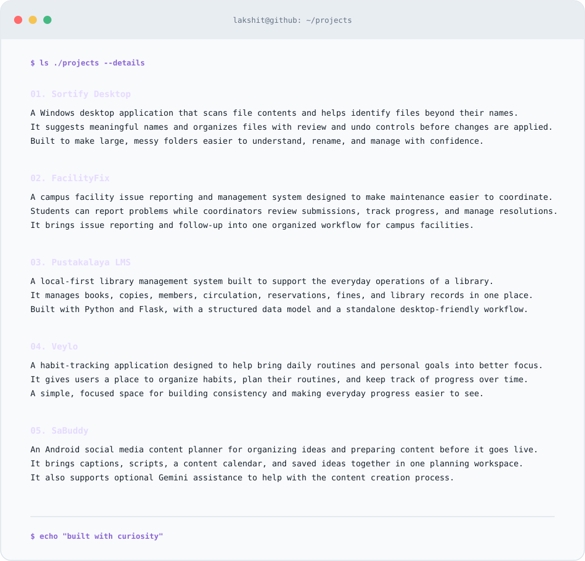

  

  

<h2 align="center">Tools of Trade</h2>

The technologies and tools I use to bring ideas to life.

<h3 align="center">Languages</h3>

  

<h3 align="center">Frameworks &amp; UI</h3>

  

<h3 align="center">AI &amp; Machine Learning</h3>

  

LangChain · Codex

<h3 align="center">Databases</h3>

  

<h3 align="center">Tools &amp; Platforms</h3>

  

Still exploring. Still building. Always curious.

